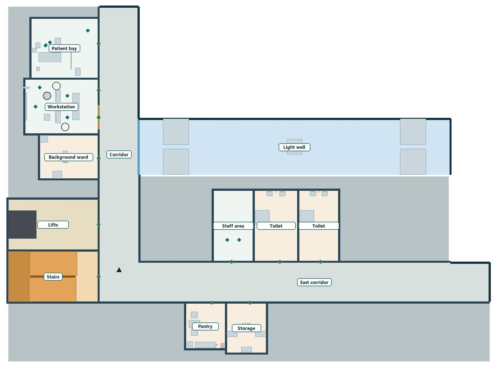

[English](README.md) | [简体中文](README.zh-CN.md)

# World Chronicle — being read, and keeping your own explanation

[Project page](https://ruixiaozhang.com/index_EN#work-aidirector)

World Chronicle is my master's thesis work: an interactive narrative set in a fictional hospital, where a system tries to read the player, and the player can inspect, correct or refuse that reading.

A UE runtime still of the ward where a shift happens. It shows the setting, not evidence that complete tasks are playable.

## How it plays

Players begin by describing how they want to play and responding to a set of situated questions. The work is designed around a provisional system reading that they can inspect, expand, correct or refuse.

Inside the hospital, the player takes one of three roles (doctor, nurse or cleaner) and works a shift with a supervisor and colleagues played by AI. Both sides make their own judgements as situations unfold. Every choice is written into a world chronicle: the path that happened lights up, and the paths not taken stay visible for review afterwards.

## Where it stands: mid-term review, October 2026

The prototype runs from the intake to an Unreal Engine hospital assembled for that session and a first-person entry. AI colleagues walk to a bedside, sit down, read a handover card and reply, and the opening story beats complete in one continuous run.

[Watch the mid-term demo (1:21, 720p, no audio)](docs/media/world-chronicle-demo-720p.mp4)

The demo uses a synthetic answer set and automated input; it is not a recording of a human player. Its opening shows sample answers to three of the spatial questions. A development panel was blurred for about fifteen seconds because it showed internal questionnaire references.

Still to come: a complete shift, branches that lead choices to genuinely different consequences, and a roughly twenty-minute play session with replay interviews. Participant studies have not begun.

## Space and choice

Beds, curtains and the space beside them decide where people stand to talk, and quietly shape what the player decides.

One session's hospital floor. How wards, the workstation and corridors connect sets the task route and what the player passes on the way. Room names were relabelled for this page.

## My work

Artistic concept, interaction design, the research framework and prototype development. The thesis studies, through design, how people and AI come to understand each other, and how players explain their own choices in action and on review.

## Related

[AINPC CHI](https://github.com/Shawn200212/AINPC-CHI) · [AIWG](https://github.com/Shawn200212/AI-World-Generator)

[Disclosure](DISCLOSURE.md) · [Media inventory](docs/public-media.json) · [Rights and credits](RIGHTS_AND_CREDITS.md)

Overview updated 28 October 2026. The text, images and demo mirror the project website. This repository is a research overview, not a runnable project or a complete research artifact.
